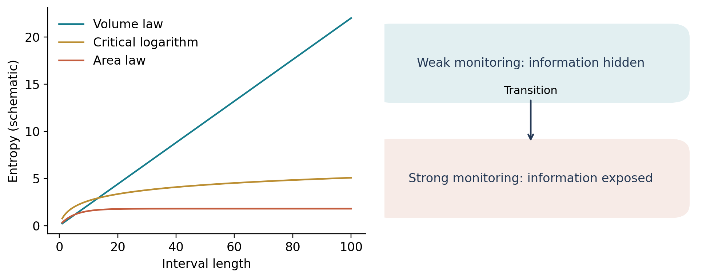

# The measurement-induced entanglement transition {#sec-measurement-transition}

A single local measurement can remove a Bell pair. It is tempting to conclude that a nonzero density of measurements must remove all long-range entanglement. The measurement-induced phase transition shows why this conclusion fails: a many-body circuit can reorganize information into a form that small local observations reveal very inefficiently. The transition concerns the conditional quantum state available to an observer who knows the measurement record.

Skinner, Ruhman, and Nahum and, independently, Li, Chen, and Fisher established the two-phase phenomenon in monitored many-body dynamics [@c_skinner2019; @c_li2018]. Their complementary geometric and stabilizer approaches remain useful precisely because they expose different aspects of the problem.

## Define the experiment before defining the phase

Take the brickwork circuit of @sec-random-circuits. After each gate layer, independently select each site for a computational-basis measurement with probability $p$. Let $\mathcal L$ specify the selected locations and $\mathbf m$ their outcomes. The gate sequence $\mathbf U$ and $\mathcal L$ are externally sampled classical variables. The outcomes are sampled using the Born rule; they are not independent coin flips.

The product of unitary and measurement operators is $K_{\mathbf m}$, with its dependence on $\mathbf U,\mathcal L$ implicit. For a pure initial state,

$$
|\widetilde\psi_{\mathbf m}\rangle=K_{\mathbf m}|\psi_0\rangle,
\quad
P_{\mathbf m}=\langle\widetilde\psi_{\mathbf m}|\widetilde\psi_{\mathbf m}\rangle,
\quad
|\psi_{\mathbf m}\rangle=P_{\mathbf m}^{-1/2}|\widetilde\psi_{\mathbf m}\rangle.
$$ {#eq-mipt-trajectory}

A bar over entropy will mean

$$
\overline{S_n(A)}=
\mathbb E_{\mathbf U,\mathcal L}\sum_{\mathbf m}
P_{\mathbf m}\,S_n(\rho_{A,\mathbf m}).
$$ {#eq-mipt-average}

This definition contains three logically distinct averages. Random circuit realizations and measurement locations can be chosen before the experiment. Outcome probabilities depend on the evolving state. A simulation that replaces the final sum by a uniform average of records usually studies a different ensemble.

We examine the entropy at the same point of each layer, for example immediately after measurements, and first take a sufficiently long evolution for the subsystem and size under study. In finite systems the term “steady state” denotes a time-stationary distribution of trajectories, not convergence to one wavefunction.

For an interval $A$ of length $\ell$ in a one-dimensional chain, the two characteristic forms are

$$
\begin{aligned}
\text{volume law:}\quad&\overline{S_n(A)}=s_n(p)\ell+o(\ell),\qquad s_n(p)>0,\\
\text{area law:}\quad&\overline{S_n(A)}=O(1).
\end{aligned}
$$ {#eq-mipt-phase-laws}

In one dimension an interval has two boundary points, so a boundary law is a size-independent constant. At the transition of the usual short-range circuits, numerical and field-theory evidence supports logarithmic scaling,

$$
\overline{S_n(A)}=\alpha_n\ln\ell+O(1).
$$ {#eq-mipt-critical-log}

The coefficient $\alpha_n$ is associated with an entanglement twist observable of the effective critical theory. It is not automatically $c(1+1/n)/6$ with the central charge of a unitary ground-state CFT.

{#fig-entropy-regimes}

## What the observer retains

Keeping the outcome in an orthogonal classical register $M$ produces

$$
\rho_{SM}=\sum_{\mathbf m}P_{\mathbf m}
\rho_{S,\mathbf m}\otimes|\mathbf m\rangle\langle\mathbf m|.
$$ {#eq-mipt-record-register}

Forgetting the record instead gives $\rho_S=\sum_{\mathbf m}P_{\mathbf m}\rho_{S,\mathbf m}$. These are different physical resources. In particular, $S(\rho_A)$ of the latter state is not the mean trajectory entanglement. Entropy is concave, so

$$
S\!\left(\sum_{\mathbf m}P_{\mathbf m}\rho_{A,\mathbf m}\right)
\geq\sum_{\mathbf m}P_{\mathbf m}S(\rho_{A,\mathbf m}),
$$ {#eq-mipt-concavity}

and the difference can be extensive.

### Worked example: a transition diagnostic invisible in a mixed state

Consider two ensembles of two-qubit pure states. Ensemble I contains $|00\rangle$ and $|11\rangle$ with equal probabilities; its mean trajectory entanglement is zero. Ensemble II contains $(|00\rangle\pm|11\rangle)/\sqrt2$ with equal probabilities; its mean trajectory entanglement is $\ln2$. Both have the same density matrix,

$$
\rho_{AB}=\tfrac12|00\rangle\langle00|+
\tfrac12|11\rangle\langle11|.
$$

Every observable linear in this averaged density matrix has the same expectation in the two ensembles. Yet their mean pure-state entanglement differs. The record tells us which pure state was prepared. This example explains why one cannot search for the usual trajectory transition using only an unconditioned local magnetization.

It is also why ordinary dephasing dynamics and ideal monitored dynamics are not interchangeable. Averaging projective $Z$ outcomes produces dephasing; conditioning on an observed outcome produces a pure trajectory when the initial state and all other operations are pure.

## Why measurements need not immediately win

Suppose a rank-one projective measurement on a qudit in $A$ produces outcome $m$, with no feedback. Before the measurement the full $AB$ state is pure, and each conditional postmeasurement state is pure. The average loss of entanglement is therefore

$$
\Delta S_A=S(\rho_B)-\sum_m p_mS(\rho_{B|m})=I(B:M),
$$ {#eq-mipt-information-loss}

where the mutual information is evaluated in the postmeasurement classical–quantum state. Thus $0\leq\Delta S_A\leq H(M)\leq\ln q$. A measurement reduces entanglement only to the extent that its outcome learns something about the opposite region.

The bound permits a large loss, but does not require one. Scrambling can distribute information over many sites so that an individual outcome carries little information about a distant encoded degree of freedom. In a weakly monitored steady state the entanglement structure is adjusted by the history of measurements; it is not simply a fresh maximally entangled Page state at every time. This qualification matters: a naive rate balance using a fully random global state would substantially overestimate the information removed by each measurement.

The exact tensor-network bound gives a second explanation. At low measurement density, isolated zero-cost bonds do not form an arbitrarily cheap long route through spacetime. A cut still crosses a positive density of costly bonds, leaving an extensive entropy possible. At high density, cuts can move through measurement-rich regions at low cost, preventing a volume law.

The high-$p$ phase is often called a quantum Zeno phase. That name is motivated by the suppression of coherent entangling dynamics under frequent observation. It does not imply that every finite-$p$ trajectory is a time-independent eigenstate of one Hamiltonian. The circuit continues to evolve, outcomes fluctuate, and short-range entanglement can be present.

## The solvable geometric limit and its boundaries

Replace every unmeasured tensor-network bond by cost one and every rank-one measured bond by cost zero. Define the model entropy as the minimum cost of a cut times $\ln q$. In generic-rank tensor-network settings the Hartley entropy $S_0=\ln\operatorname{rank}\rho_A$ can saturate this bound; the geometric model also controls leading entropies in appropriate large-$q$ limits. Its transition is a percolation problem: zero-cost measurement bonds eventually connect into system-spanning cheap routes.

For the self-dual square-lattice bond-percolation version, the threshold is $p_c=1/2$ and $\nu=4/3$. These numbers belong to that specified geometric problem. They are not exact predictions for a qubit Haar circuit's von Neumann entropy. The ordering of limits matters: at $q\to\infty$ the geometric cost controls the leading entropy, while subleading structure and finite-$q$ interactions can affect the critical theory. The Hartley entropy is also sensitive to arbitrarily small nonzero Schmidt coefficients, which the von Neumann entropy downweights.

At geometric criticality there are structures on every scale. A cut accumulates $O(1)$ additional unavoidable cost on successive logarithmic length scales, motivating $S\sim\ln\ell$. Away from criticality the correlation length

$$
\xi\sim|p-p_c|^{-\nu}
$$ {#eq-mipt-correlation-length}

cuts off that hierarchy. Below threshold, large scales recover a positive line tension and a volume law; above threshold the cut escapes at finite cost. This reasoning explains the geometry of the transition without claiming that geometry alone determines the generic quantum exponents.

A finite-$q$ circuit contains amplitude interference, a nonuniform entanglement spectrum, and replica-domain-wall interactions. The mapping in @sec-replica-mechanics makes these differences explicit. The generic transition and Clifford transition can have close estimates of $\nu$ while differing in operator dimensions and effective central charges [@c_zabalo2022]. Agreement with $4/3$ within a modest error bar is therefore insufficient evidence for percolation universality.

## How to identify a transition numerically

A plot of half-chain entropy against $p$ at one size shows a crossover, not a thermodynamic singularity. A useful analysis varies size, time, and measurement rate separately. The basic dynamic scaling hypothesis is

$$
\xi_t\sim\xi^z,\qquad
\overline{S_n(\ell,t;p_c)}\sim
\alpha_n\ln\!\big[\min(\ell,t^{1/z})\big]+O(1)
$$ {#eq-mipt-dynamic-scaling}

away from microscopic scales and boundaries. For the conventional short-range critical circuits, evidence commonly supports $z\simeq1$ after rescaling the time axis. This need not hold with static disorder, conservation laws, long-range gates, or altered monitoring protocols.

For a periodic chain at a conformally invariant critical point, the interval length is replaced by the chord length,

$$
\overline{S_n(\ell,L)}=
\alpha_n\ln\left[\frac{L}{\pi}\sin\!\left(\frac{\pi\ell}{L}\right)\right]+b_n+\cdots.
$$ {#eq-mipt-chord-entropy}

A logarithm can mimic a very small entropy density on limited sizes. Likewise an area-law phase with large $\xi$ can look critical. The diagnostic should therefore remove the leading entropy term where possible.

Partition a periodic chain into four consecutive equal regions $A,B,C,D$ and form

$$
I_3(A:B:C)=S_A+S_B+S_C-S_{AB}-S_{AC}-S_{BC}+S_{ABC}.
$$ {#eq-mipt-tripartite}

Compute this combination for each trajectory, then average. In the area-law phase it tends toward zero when regions are much larger than $\xi$. In a volume-law phase with scrambled multipartite correlations it is generally negative and extensive for this geometry. At criticality the leading logarithms and cutoff terms cancel in the appropriate combination, leaving a dimensionless function of fixed cross ratios. This motivates

$$
\overline{I_3}(p,L)=F\!\left[(p-p_c)L^{1/\nu}\right]+L^{-\omega}G\!\left[(p-p_c)L^{1/\nu}\right]+\cdots.
$$ {#eq-mipt-finite-size-scaling}

Crossings drift because of corrections, finite times, and statistical errors. Zabalo and collaborators used tripartite information to improve finite-size diagnostics in Haar circuits [@c_zabalo2020]. Their threshold estimate near $0.17$ pertains to their specified qubit circuit; a threshold is not universal and must always be paired with the measurement protocol.

### Worked example: why the tripartite combination is extensive in a scrambled phase

Take an idealized pure state on $L$ qubits for which every region up to half the system has entropy equal to its size times $s$, neglecting boundary corrections. Let the four regions each have $L/4$ sites. Then $S_A=S_B=S_C=S_{ABC}=sL/4$, while $S_{AB}=S_{AC}=S_{BC}=sL/2$. Thus

$$
I_3=4(sL/4)-3(sL/2)=-sL/2.
$$

The negative value detects information that is shared nonlocally rather than decomposing into independent pairwise correlations. This estimate is an illustrative maximally scrambled geometry, not a theorem that fixes $I_3$ for every volume-law state. A product of Bell pairs can have a volume-law entropy for a chosen partition without the same multipartite structure.

## A minimal simulation protocol

For an exact-state simulation, store $2^L$ amplitudes, apply two-site gates by reshaping the relevant indices, and sample measurements from the actual instantaneous probabilities. For site $i$ calculate $p_0=\langle P_{i,0}\rangle$, draw a uniform number $r$, choose $m=0$ if $r<p_0$, and update $|\psi\rangle\mapsto P_{i,m}|\psi\rangle/\sqrt{p_m}$. The normalization factor is mandatory. A zero-probability outcome must never be selected.

For entropy, reshape the normalized state into a matrix $\Psi_{a b}$ using the desired bipartition. Its singular values $s_j$ give eigenvalues $\lambda_j=s_j^2$ of $\rho_A$. Compute $-\sum_j\lambda_j\ln\lambda_j$, defining $0\ln0=0$. This is numerically more stable than forming a large reduced density matrix, and handles arbitrary disconnected regions if the indices are first permuted correctly.

A trustworthy demonstration checks the following physical limits. At $p=0$, entropy grows and approaches a volume law. At $p=1$, observing immediately after a complete single-site measurement layer gives an exact product state and zero entropy. Norms remain one after every sampled operation. Every bipartite entropy of a pure state equals that of the complement. These checks test different parts of the algorithm; reproducing a plausible curve alone does not.

Exact-state simulations at small $L$ are useful illustrations of the competition. They do not determine high-precision exponents. To study scaling, Clifford tableaux, tensor networks with convergence checks, or specialized replica and transfer-matrix methods are needed. An area-law phase facilitates matrix-product methods, but trajectory sampling, rare outcomes, and critical broad distributions can still make computations difficult.

## Problems and solutions

**1. A measurement that reveals no distant information.** Let $|\psi\rangle=|+\rangle_a\otimes|\Phi^+\rangle_{bc}$, with $A=ab$ and $B=c$. Measure $Z_a$. What is $\Delta S_A$?

**Solution.** The outcome is random but independent of $c$. Thus $I(B:M)=0$ and $\Delta S_A=0$. Randomness of an outcome is not the same as useful information about a distant subsystem.

**2. A measurement that removes all entanglement.** Instead take $|\Phi^+\rangle_{ab}$, with one qubit on each side, and measure $Z_a$.

**Solution.** The conditional state is $|00\rangle$ or $|11\rangle$. Its entropy is zero. The initial entropy was $\ln2$, and $I(b:M)=\ln2$. The outcome reveals exactly the classical label that previously participated in the coherent superposition.

**3. Why time and size cannot be conflated.** A critical system has $z=1$, but simulations use fixed depth $t=50$ for all $L$ up to $1000$. Can its half-chain entropy establish area-law scaling?

**Solution.** No. Its dynamic correlation length is only of order $t$ in suitable units. For $L\gg t$ the entropy is limited by evolution time. A systematic study must increase $t$ with $L$ and test equilibration. Slow dynamics can imitate a low-entanglement steady state.

The transition has now been defined operationally and geometrically. Its theoretical description requires a new step: an entropy is nonlinear in a normalized trajectory state, so averaging it creates interacting copies of the quantum evolution.
