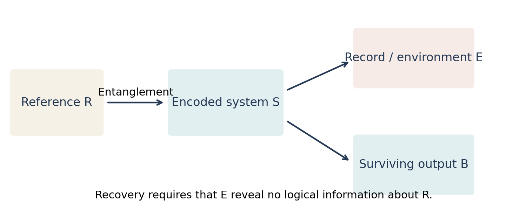

# Purification, quantum memory, and error correction {#sec-error-correction}

The entanglement transition has an operational interpretation: can an unknown quantum state survive the monitored dynamics? This question is more precise than asking whether a final state is entangled. A highly entangled state can be unrelated to its input, whereas a good quantum memory must preserve the coherence of arbitrary superpositions, including entanglement with an outside reference.

Choi, Bao, Qi, and Altman connected the competition between scrambling and observation to error correction [@c_choi2020]. Gullans and Huse developed the associated dynamical purification transition and the interpretation in terms of dynamically generated codes [@c_gullans2020]. We derive the basic identities underlying these connections and explain their limitations.

## A reference qubit is a coherence detector

Let $R$ be an inert reference and $S$ the system. Prepare one system qubit maximally entangled with $R$,

$$
|\Phi^+\rangle_{RS_1}=
\frac{|0\rangle_R|0\rangle_{S_1}+|1\rangle_R|1\rangle_{S_1}}{\sqrt2},
$$ {#eq-qec-bell-reference}

with all other system qubits initially pure. Apply an encoding circuit to $S$, then monitored evolution. The reference is never touched. For each ideal fully observed trajectory, $RS$ remains pure. Its reference entropy $S(\rho_{R|\mathbf m})$ measures the entanglement still shared with the system.

If the record determines the reference completely, the entropy is zero and this input coherence has been lost to the apparatus. If the reference remains maximally mixed in every conditional branch, it can still be maximally entangled with an encoded degree of freedom in $S$. Merely measuring a classical input label would fail to distinguish these cases, because preserving a classical bit does not guarantee preservation of a superposition.

For $K$ logical qubits use a $2^K$-dimensional reference and an encoded maximally entangled state. Initially $S(R)=K\ln2$. Because a trace-preserving operation on $S$ cannot change the unconditional $\rho_R$, this entropy stays fixed when outcomes are ignored. What changes is the conditional state of $R$ given the outcomes.

## The information balance for an ideal monitored channel

Keep the record in a classical register $M$. Its joint state with $RS$ is

$$
\rho_{RSM}=\sum_{\mathbf m}p_{\mathbf m}
|\Psi_{\mathbf m}\rangle\langle\Psi_{\mathbf m}|_{RS}
\otimes|\mathbf m\rangle\langle\mathbf m|_M.
$$ {#eq-qec-cq-state}

Block-diagonal entropy gives $S(RM)=H(M)+\sum_{\mathbf m}p_{\mathbf m}S(\rho_{R|\mathbf m})$. Therefore

$$
I(R:M)=S(R)-\sum_{\mathbf m}p_{\mathbf m}S(\rho_{R|\mathbf m}).
$$ {#eq-qec-information-balance}

This identity is exact. It says that the measurement record acquires information about the reference precisely when the conditional reference entropy decreases. In an encoded state, a local measurement may be random but reveal no logical information; random syndrome bits need not destroy the encoded qubit.

The output channel, including the record, is

$$
\mathcal N(\rho)=\sum_{\mathbf m}
K_{\mathbf m}\rho K_{\mathbf m}^{\dagger}\otimes
|\mathbf m\rangle\langle\mathbf m|_M.
$$ {#eq-qec-flagged-channel}

Its coherent information for the specified entangled input is $I_c(R\rangle SM)=S(SM)-S(RSM)$. Since every branch $RS$ is pure, $S(RSM)=H(M)$ and $S(SM)=H(M)+\sum p_{\mathbf m}S(\rho_{S|\mathbf m})$. Equality of the two reduced entropies in each pure branch yields

$$
I_c(R\rangle SM)=\sum_{\mathbf m}p_{\mathbf m}S(\rho_{R|\mathbf m}).
$$ {#eq-qec-coherent-information}

Thus conditional reference entropy directly measures coherent information in the ideal monitored problem. This equality depends on access to the complete record and purity of the conditional evolution. Additional unobserved noise makes the conditional $RS$ state mixed and removes this simple identification.

Coherent information of a chosen input is not by itself a complete evaluation of a channel's optimized, regularized quantum capacity. It is an operationally useful diagnostic and a coding lower-bound ingredient in the appropriate asymptotic channel setting. Claims about capacity must specify inputs, record access, time, and whether the channel can be repeated independently.

{#fig-qec-information-flow}

## Decoupling: the environment must not learn the logical state

A channel can always be represented by an isometry from its input into an accessible output $B$ and an inaccessible environment $E$. On an entangled input the total state $RBE$ is pure. If

$$
\rho_{RE}=\rho_R\otimes\rho_E,
$$ {#eq-qec-decoupling}

then all correlations that purify $R$ are available in $B$. A unitary or isometry acting on $B$, followed by discarding an ancillary factor, can recover the encoded state entangled with $R$. This follows from the uniqueness of purifications up to an isometry: both the actual $B$ state and an ideal recovered logical system plus ancilla purify the same product $\rho_R\otimes\rho_E$.

For approximate decoupling, closeness of purifications leads to approximate recovery. An illustrative quantitative route uses quantum Pinsker's inequality, with natural logarithms,

$$
I(R:E)=D(\rho_{RE}\Vert\rho_R\otimes\rho_E)
\geq\tfrac12\|\rho_{RE}-\rho_R\otimes\rho_E\|_1^2.
$$ {#eq-qec-pinsker}

Small mutual information implies small trace-distance correlations for this input. Converting this into worst-case recovery for every state in a code requires suitable uniform control; one should not confuse an average-input statement with a dimension-independent worst-case guarantee. Information–disturbance theorems formulate the channel-level version precisely [@c_kretschmann2006].

For @eq-qec-flagged-channel an isometric implementation can copy the classical outcome to $E$ as well as to the accessible $M$. The inaccessible environment then has only a classical copy of the record, so $I(R:E)=I(R:M)$. Equations @eq-qec-information-balance and @eq-qec-decoupling become two descriptions of the same condition: measurements must not distinguish logical states.

This explains why handing the decoder a classical record does not undo a measurement that has learned the logical amplitude. The apparatus has already acquired that information; a classical label cannot reconstruct an unknown relative phase that has been irreversibly destroyed.

## Error-correction conditions for a code subspace

Let $V:\mathcal H_L\to\mathcal H_S$ encode a logical space, and let $\Pi=VV^{\dagger}$. For an unflagged error channel with Kraus operators $E_a$, the Knill–Laflamme condition is

$$
\Pi E_a^{\dagger}E_b\Pi=c_{ab}\Pi.
$$ {#eq-qec-knill-laflamme}

It states that environmental overlaps depend only on the error labels, not on the logical state. The matrix $c$ is positive. Diagonalizing it changes the Kraus basis so that the errors carry the code into mutually orthogonal syndrome spaces with state-independent amplitudes. A recovery identifies the syndrome and reverses the corresponding isometry. This gives both the physical interpretation and a constructive proof of sufficiency [@f_kl1997].

When an error label is supplied to the decoder in an orthogonal flag, the flagged Kraus operators have orthogonal output records. The off-diagonal products vanish automatically. For the monitored channel, perfect recovery on the code therefore requires

$$
\Pi K_{\mathbf m}^{\dagger}K_{\mathbf m}\Pi
=p_{\mathbf m}\Pi
$$ {#eq-qec-flagged-condition}

for each record of nonzero probability. On the code, $K_{\mathbf m}/\sqrt{p_{\mathbf m}}$ is an isometry. Its record probability is independent of the logical input. A record-dependent decoder can invert that isometry. When this holds only approximately, the measurement history defines an approximate evolving code.

### Worked example: the basis of a measurement decides whether it is an error

Encode $\alpha|0\rangle+\beta|1\rangle$ as

$$
|\psi_L\rangle=\alpha|000\rangle+\beta|111\rangle.
$$ {#eq-qec-repetition-state}

Measure $Z$ on the first qubit. The outcomes occur with probabilities $|\alpha|^2$ and $|\beta|^2$ and reveal the logical computational-basis label. The superposition is destroyed. In the code space $\Pi Z_1\Pi$ is a logical $Z$, so the measurement probabilities depend on the logical state and @eq-qec-flagged-condition fails.

Instead measure $X_1$, with $|\pm\rangle=(|0\rangle\pm|1\rangle)/\sqrt2$. Each outcome has probability $1/2$, independent of $\alpha,\beta$, and the conditional state is

$$
|\pm\rangle_1\otimes
(\alpha|00\rangle_{23}\pm\beta|11\rangle_{23}).
$$ {#eq-qec-repetition-measured}

For outcome minus, apply $Z$ on qubit 2 to remove the sign. The logical state remains encoded in qubits 2 and 3 and can be decoded by controlled-NOT and a change of register. The measured physical qubit has lost entanglement, but the logical qubit survives. This code is not a code correcting every single-qubit error; the example illustrates correction of one specified observed measurement.

## Purification converts unknown input into a mixed initial state

Prepare the system maximally mixed, $\rho_0=I/q^L$. This can be viewed as tracing the reference out of $L$ maximally entangled pairs. Under a trajectory,

$$
\rho_{S|\mathbf m}(t)=
\frac{K_{\mathbf m}K_{\mathbf m}^{\dagger}}
{\operatorname{Tr}K_{\mathbf m}K_{\mathbf m}^{\dagger}}.
$$ {#eq-qec-mixed-trajectory}

The conditional entropy measures uncertainty about the initial quantum degrees of freedom that has not been eliminated by the record. With a purifying reference included, it also equals the trajectory reference entropy, because the joint state remains pure.

In the strongly measured phase, local information is acquired efficiently and conditional entropy falls rapidly. In the weakly measured coding phase of conventional ideal monitored circuits, an extensive residual entropy can survive for times that are exponentially large in $L$. A useful hierarchy is a local scrambling time, a time of order the system's traversal time, and a much larger purification time. At criticality, characteristic purification times instead show finite-size power-law scaling in the usual setting [@c_gullans2020].

The thermodynamic and long-time limits cannot be interchanged. For a finite generic monitored system with enough complete observations, even a weak measurement rate will eventually determine the state to high accuracy. The coding phase means that this time diverges rapidly with size; it does not mean that a finite quantum memory remains protected forever without qualification. For example, a full layer of single-site rank-one observations occurs with probability $p^L$ in the independent-location model and immediately purifies the system. Its waiting time is exponential in $L$, already illustrating a rare event that matters at infinite time.

For the familiar spatially local, fully monitored random circuits without additional constraints, the purification transition and the pure-state entanglement transition occur together. The channel formulation also applies where the usual spatial area-versus-volume distinction is less natural, such as all-to-all circuits. With conservation laws, partial observation, or noise there can be further transitions and distinct information measures, so the coincidence should not be elevated to a theorem for arbitrary dynamics.

## Dynamically generated codes and their geometry

For a mixed stabilizer state on $L$ qubits, suppose $r$ independent stabilizers have been learned. Its density matrix is proportional to the projector onto their common eigenspace. That subspace has dimension $2^{L-r}$ and entropy

$$
S=(L-r)\ln2.
$$ {#eq-qec-stabilizer-code-entropy}

The $K=L-r$ remaining qubits are logical degrees of freedom. Clifford gates transport and spread stabilizers; measurements can add information or change the generating set. The code is therefore updated dynamically rather than fixed once at the start.

The *rate* is $K/L$. The *distance* asks how small a physical operator can act nontrivially on the logical space without being detected. In local dynamics, one may instead ask for a *contiguous distance*: the smallest interval whose erasure can significantly reveal logical information. These are different definitions. A code can have a finite rate and yet a subextensive contiguous distance. Li and Fisher relate this geometry to entanglement domain walls and their fluctuations [@c_lifisher2021].

For an erasure region $A$, imagine transferring its full state to the environment. With a purifying reference, exact correctability is equivalent to $I(R:A)=0$. In a stabilizer code this can be checked by linear algebra on supported Pauli operators. In the replica statistical mechanics it becomes a competition between configurations in which domain walls connect different boundary regions. A geometrically small erased region may fail to intersect the information-bearing structure even when the full state has a volume-law entropy.

The rate, distance, memory time, and decoding cost answer different questions. Demonstrating a coding phase does not automatically provide an efficient practical decoder. A recovery map may exist information-theoretically but be computationally expensive, or require detailed knowledge of the circuit. Conversely a specific efficient decoder can have a threshold below the optimal threshold. This distinction will become especially important for learnability transitions.

## Experiments and the record bottleneck

Directly estimating trajectory entanglement is difficult because a long record is unlikely to repeat. Postselecting on one complete record can require a number of experimental shots exponential in the number of measurement outcomes. A reference-qubit protocol reduces the quantum subsystem to be characterized, but still needs a way to use the record. Clifford dynamics, known feed-forward corrections, classical simulation, and spacetime duality can provide such methods in different experimental settings.

Noel and collaborators observed signatures of the purification phases in a trapped-ion device using reference and decoding ideas [@c_noel2022]. Experiments on superconducting processors have used spacetime duality and decoding-based diagnostics to access measurement-induced entanglement and teleportation signatures at larger qubit counts [@c_google2023]. These are finite-size observations with hardware noise and protocol-specific diagnostics. They establish access to the relevant information physics; they do not by themselves establish every asymptotic exponent of the ideal infinite circuit.

Measurement can also create useful entanglement rather than only destroy it. In entanglement swapping, two initially separate Bell pairs become a Bell pair between their outer qubits after a joint measurement of the inner qubits, with a record-dependent Pauli correction. The conditional correlation can extend beyond a unitary light cone in spacetime-dual constructions. It cannot transmit a usable signal without the classical record: averaged over unknown outcomes, the remote observers lack the corrected Bell state. Causality is preserved.

## Problems and solutions

**1. A classical memory is insufficient.** The channel measures an input qubit in $Z$, stores the result, and outputs the corresponding $Z$ eigenstate. Does it preserve a classical bit? Does it preserve half of a Bell pair?

**Solution.** It preserves inputs $|0\rangle$ and $|1\rangle$ perfectly, so it is a perfect classical bit channel in that basis. Applied to half of $|\Phi^+\rangle$, it produces the separable mixture of $|00\rangle$ and $|11\rangle$ when the outcome is ignored. Even with the outcome known, each branch is a product. Its quantum coherent information for this input is zero.

**2. A record-independent isometry.** Suppose $K_mV=\sqrt{p_m}W_m$, where $W_m^{\dagger}W_m=I_L$ and $p_m$ does not depend on the logical input. Construct a recovery.

**Solution.** Read the orthogonal record $m$. On the image of $W_m$, apply its inverse isometry $W_m^{\dagger}$. Extend this to a trace-preserving map on the full output space by mapping the orthogonal complement to a fixed logical state. On encoded inputs the complement is never occupied, so recovery is perfect. This proves the flagged condition directly.

**3. Entropy decrease under observation.** Can an individual unlikely outcome increase the conditional reference entropy?

**Solution.** Yes, conditional entanglement concentration can increase entropy in a selected branch. Equation @eq-qec-information-balance constrains the average: $I(R:M)\geq0$, so the Born-averaged reference entropy cannot exceed its premeasurement value under a local observed instrument acting on $S$. A branchwise monotonicity claim would be too strong.

**4. Why more entropy is not always more useful.** Add independent unobserved depolarizing noise to a system. Its entropy can increase. Does that imply improved quantum memory?

**Solution.** No. The noise can move correlations with $R$ into an inaccessible environment. System entropy then mixes local ignorance with retained logical uncertainty. The correct diagnostic includes reference correlations or coherent information; the ideal equality in @eq-qec-coherent-information no longer applies.

The central mechanism is now explicit. Scrambling distributes quantum information, monitoring tries to extract it, and a code is the organization that makes the extracted record insensitive to logical states. The entanglement transition is one geometric manifestation of this competition; symmetry and incomplete observation introduce further possibilities.
