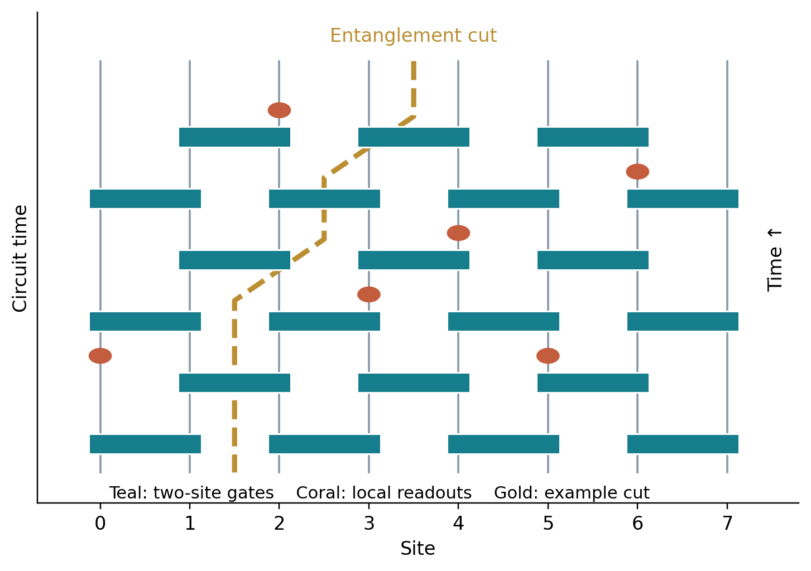

# Numerical laboratory: trajectories and inference {#sec-numerical-laboratory}

## What a numerical demonstration can establish

The calculations in this chapter are small enough to understand completely. They implement a monitored qubit circuit, Bayesian learning of a conserved two-valued variable, and Gaussian filtering of a diffusive density. These are different models. Their shared lesson is that retained records change an observer's uncertainty, while the dynamical constraints determine how information becomes accessible.

The circuit calculation uses **exact state vectors**, not a truncation of the wavefunction. The only statistical error comes from finite trajectory sampling; floating-point roundoff is checked separately. Nevertheless, lengths $L=6,8,10$ are too small to locate a thermodynamic critical point reliably. The figures demonstrate a monitoring-dependent crossover and verify the expected endpoints. They are not a determination of a universal exponent or threshold.

All data used in this chapter are included with the book:

- [Julia simulation and validation](numerics/monitored_circuit.jl).
- [Trajectory-averaged entropy data](assets/data/circuit_entropy.csv).
- [Figure-generation script](numerics/make_figures.py).

The Julia program uses only `LinearAlgebra`, `Random`, `Statistics`, and `DelimitedFiles`, which are part of the standard distribution. It requires no package installation. Run the validation checks with:

```sh
julia numerics/monitored_circuit.jl --validate
```

Omit `--validate` to regenerate the data. The included data were generated with Julia 1.12.6. Random seeds are explicit, but bitwise reproduction across different Julia or linear-algebra versions is not promised; statistical conclusions and validation identities are the reproducible objects.

## An exact monitored Haar circuit

Use an open chain initialized in $|0\rangle^{\otimes L}$. One time step consists of two layers of independent Haar-random two-qubit gates: first on bonds $(0,1),(2,3),\ldots$, then on $(1,2),(3,4),\ldots$. After these two layers, each site is measured projectively in $Z$ with independent probability $p$. The entropy is recorded **after** this measurement layer. Changing where the readout occurs in the brickwork changes the microscopic model and can shift its transition probability.

{#fig-lab-circuit}

The state vector has $2^L$ complex entries. We identify basis labels with binary integers, with site zero the least significant bit. For a gate on neighboring sites $j,j+1$, every assignment of the remaining bits defines a four-component vector. Multiplying each such block by the same $4\times4$ unitary applies the two-site gate exactly.

For example, at fixed other bits the four amplitudes are ordered as $(00,10,01,11)$ in the bit convention of the code. A Haar distribution is invariant under a fixed basis permutation, so this order creates no ensemble ambiguity. The entropy cut uses the same convention: Julia's column-major `reshape(psi, 2^cut, :)` makes the first index enumerate the low-order subsystem bits.

### Drawing a Haar gate

Generate a $4\times4$ matrix $Z$ whose entries are independent isotropic complex Gaussians. Write its QR factorization as $Z=QR$. The diagonal phases of $R$ depend on the numerical convention, so correct them:

```julia
z = (randn(rng,4,4) + im*randn(rng,4,4))/sqrt(2)
f = qr(z)
U = Matrix(f.Q) * Diagonal(diag(f.R) ./ abs.(diag(f.R)))
```

The Gaussian law is invariant under left multiplication by a fixed unitary. With a positive-real diagonal convention for the triangular factor, this invariance makes the corrected $U$ Haar distributed. The probability of an exactly zero diagonal entry is zero in the ideal continuous distribution. The code checks $\|U^\dagger U-I\|<10^{-12}$ on sample gates.

### Born sampling and normalization

For site $j$, let $p_1=\sum_{b:b_j=1}|\psi_b|^2$. Draw a uniform random number $u\in[0,1)$ and choose outcome one when $u<p_1$. Set incompatible amplitudes to zero and divide compatible amplitudes by $\sqrt{p_1}$ or $\sqrt{1-p_1}$. This is precisely the projective update in @eq-instrument.

It is incorrect to choose outcomes with equal probability after a generic gate. It is also incorrect to normalize a forbidden outcome and then attempt to repair the resulting infinities. A tiny numerical probability is sampled rarely; a mathematically zero probability is never sampled. The implementation clamps roundoff in $p_1$ to $[0,1]$ and checks the state norm after every full time step.

### Entropy from singular values

Reshape $\psi$ into the coefficient matrix $C_{ab}$ for the chosen cut. Its singular values are $\sqrt{\lambda_\alpha}$, so

$$
S_A=-\sum_\alpha\lambda_\alpha\ln\lambda_\alpha.
$$ {#eq-lab-svd-entropy}

The code discards values below $10^{-15}$ only in this scalar entropy sum to avoid evaluating $\ln0$. It does not truncate the evolved state. For $L\leq10$, both the matrix and its full singular-value decomposition are small.

## Results and statistical errors

For each $(L,p)$, the data contain 64 independent trajectories evolved for 60 time steps. Gates, measurement locations, and Born outcomes are sampled afresh. At each recorded time the standard error is the sample standard deviation across independent trajectories divided by $\sqrt{64}$. Points at different times along one trajectory are correlated and should not be counted as independent repetitions.

{#fig-lab-entropy}

At $p=0$, local gates rapidly build entanglement and the entropy approaches the scale expected for a highly scrambled pure state. The finite chain cannot exceed $(L/2)\ln2$ at its half cut; typical Haar states lie below that bound by an order-one correction. At $p=1$, every site is measured after every time step, so the sampled final state is a computational-basis product and its entropy vanishes. At intermediate $p$, some entanglement survives the readout layer, with a broad crossover in these sizes.

These trends are consistent with the physical picture developed in the transition chapter, but they do not establish whether a particular intermediate parameter lies on one side of the infinite-chain transition. To do that one needs larger systems, a fixed scaling protocol, observables with known finite-size behavior, and careful uncertainty estimation.

### Validation identities

The simulation validates five independent facts: Haar-gate unitarity, norm preservation, Bell-pair entropy $\ln2$, product-state entropy zero, and zero entropy at $p=1$ at the measurement times used. It also repeats measurement of independently prepared Bell states 4,000 times and checks that the frequency of outcome one is near one-half. This last check tests the sampling distribution rather than a single deterministic trajectory.

The assertions are not proof that every possible modification is correct. They are useful because they test mathematical properties that survive changes of random seed and are not tied to one plotted curve. For serious new work, also compare gate application against an explicitly constructed small tensor product, compute reduced density matrices by a second method, and test a solvable circuit family.

## A browser experiment: accumulation of evidence

The next experiment implements the exact Bayesian rule in @eq-log-odds for a hidden fixed variable $z=\pm1$ with equal prior. Each readout is correct with probability $(1+\eta)/2$. Adjust the readout strength, number of samples, and seed. The teal curve is the posterior probability of $z=+1$; the coral curve is the posterior Shannon entropy divided by $\ln2$. A weak record can temporarily favor the wrong hypothesis.

```{=html}
<div class="lab-panel" id="bayes-lab">
<label for="eta">Readout strength η: <output id="eta-out">0.18</output>
<input id="eta" type="range" min="0" max="1" step="0.01" value="0.18"></label>
<label for="samples">Number of readouts: <output id="samples-out">200</output>
<input id="samples" type="range" min="10" max="600" step="10" value="200"></label>
<label for="seed">Random seed <input id="seed" type="number" min="1" max="999999" value="23"></label>
<button type="button" id="resample">Next record</button>
<p id="bayes-status" aria-live="polite"></p>
<canvas id="bayes-canvas" width="900" height="380" aria-label="Posterior probability and normalized posterior entropy versus number of readouts" role="img"></canvas>
</div>
<script src="assets/bayes-lab.js"></script>
```

For the PDF and as a static comparison, here is one particular record with true $z=+1$:

{#fig-lab-bayes}

The posterior entropy can rise after a surprising readout, even though its average over the next outcome cannot increase for this fixed hidden-variable problem. To derive the average statement, write

$$
H(Z|M_{1:t})-\mathbb E_{M_{t+1}|M_{1:t}}H(Z|M_{1:t+1})
=I(Z:M_{t+1}|M_{1:t})\geq0.
$$ {#eq-lab-entropy-reduction}

Thus an individual observer can become less certain after a particular measurement without violating the information inequality. Monitoring a scrambling many-body system adds spatial constraints and hidden dynamical variables, but this elementary distinction between a trajectory and an average remains.

At $\eta=0$, readouts carry no information and the posterior stays one-half. At $\eta=1$, the first readout identifies $z$ exactly. For weak $\eta$, the mean log-likelihood gained per readout under the true positive hypothesis is

$$
\mathbb E[\Delta\ell|z=+1]
=\eta\ln\frac{1+\eta}{1-\eta}
=2\eta^2+O(\eta^4).
$$ {#eq-lab-information-time}

A constant-confidence discrimination time therefore grows as $\eta^{-2}$ in this elementary model. This is a signal-to-noise result, not a many-body phase transition. Keeping that distinction explicit makes the nontrivial charge-learning problem easier to recognize.

## Gaussian filtering of a conserved density

The hydrodynamic chapter develops full-record conditional correlations. Here we solve the related **causal filtering** problem: infer the density at time $t$ using observations available up to time $t$. A future observation can further constrain a past density, so filtering and smoothing have different covariance coefficients.

For a Fourier mode of a diffusive density, use

$$
dn_k=-Dk^2n_k\,dt+\sqrt{2D\chi k^2}\,dW_k,
\qquad dY_k=2\sqrt\gamma n_k\,dt+dV_k.
$$ {#eq-lab-linear-filter}

The noises are independent, with the real-field constraint relating $k$ to $-k$. The unmonitored stationary variance is $\chi$, because the Ornstein–Uhlenbeck variance balances $-2Dk^2\chi$ against $2D\chi k^2$.

For a Gaussian posterior, let $V_k$ be the conditional variance. A prediction step changes it by $(-2Dk^2V_k+2D\chi k^2)dt$. A noisy linear readout has precision $4\gamma dt$; adding this precision gives the leading update $V_k\to V_k-4\gamma V_k^2dt$. Therefore

$$
\partial_tV_k=-2Dk^2V_k+2D\chi k^2-4\gamma V_k^2.
$$ {#eq-lab-riccati}

Taking the nonnegative stationary root gives

$$
V_k=\frac{\sqrt{D^2k^4+8\gamma D\chi k^2}-Dk^2}{4\gamma}.
$$ {#eq-lab-filter-spectrum}

For $|k|\gg\sqrt{\gamma\chi/D}$ it approaches $\chi$. At small nonzero $k$, $V_k\simeq\sqrt{D\chi/(2\gamma)}|k|$. Local observations suppress long-wavelength uncertainty particularly strongly because conservation makes those modes slow. The exact $k=0$ mode is conserved; its filtering variance decays in time rather than obeying a nonzero stationary Ornstein–Uhlenbeck balance. The stationary small-$k$ limit and the finite-time zero mode must be distinguished.

{#fig-lab-filtering}

A $|k|$ structure factor produces logarithmic subsystem fluctuations in one dimension. For $Q_\ell=\int_0^\ell n(x)dx$,

$$
\operatorname{Var}Q_\ell=\int\frac{dk}{2\pi}V_k
\frac{4\sin^2(k\ell/2)}{k^2}.
$$ {#eq-lab-charge-integral}

Putting $V_k=A|k|$ below a cutoff gives $(2A/\pi)\ln\ell+O(1)$. In contrast, a constant $V_k=\chi$ gives a variance proportional to $\ell$. This calculation shows directly how an information-gathering process can create scale-invariant conditional fluctuations in an underlying diffusive classical system. It does not include charge quantization, vortices, non-Abelian recoupling, or a quantum entanglement sector. Those additions are precisely where the frontier theories become richer.

## Designing a credible scaling study

A useful next calculation would use a stabilizer circuit to reach hundreds of qubits, while keeping clear that its universality must be established separately from Haar circuits. Alternatively, a matrix-product-state simulation can follow larger systems in low-entanglement regimes, with bond-dimension convergence checked at the transition. Exact vectors remain valuable as a benchmark.

A research study should specify a time-to-size scaling rule before fitting. It should report the observable, boundary conditions, gate/readout sequence, trajectory count, and uncertainty method; examine crossing drift; and compare several scaling windows. Bootstrap whole trajectories rather than individual time points when estimating errors. For a BKT transition, test an essential singularity and stiffness or defect diagnostics rather than assuming a finite power-law exponent. For disorder, examine distributions as well as means.

These practices are not administrative details. A finite record can mimic a learning transition, a finite bond dimension can mimic an area law, and a rare-event-dominated mean can conceal typical behavior. Understanding how each artifact arises is part of understanding the physics.

## Problems with solutions

### Sampling error

If the standard deviation of trajectory entropy is 0.8 nats, what trajectory count gives a standard error of 0.02 nats under independent sampling?

**Solution.** Solve $0.8/\sqrt N=0.02$, giving $N=1600$. Correlated trajectories or rare heavy tails can invalidate this simple estimate; the independence assumption must be checked in the simulation protocol.

### Why normalize each step?

Explain why a long unnormalized trajectory is numerically inconvenient even when its final normalized state is well defined.

**Solution.** Its norm squared is the probability of the entire record, often exponentially small in spacetime volume. Floating-point underflow can erase it. Stepwise normalization factors can instead be accumulated as logarithms to retain the record likelihood while the vector remains well scaled.

### Filtering crossover

Estimate the crossover wave number in @eq-lab-filter-spectrum and the associated length.

**Solution.** Equate $D^2k^4$ and $8\gamma D\chi k^2$, giving $k_*\sim\sqrt{\gamma\chi/D}$ up to an order-one factor. The length is $\ell_*\sim\sqrt{D/(\gamma\chi)}$. It is a monitoring-induced crossover scale in a Gaussian theory, not a diverging correlation length at a nonzero critical monitoring rate.
