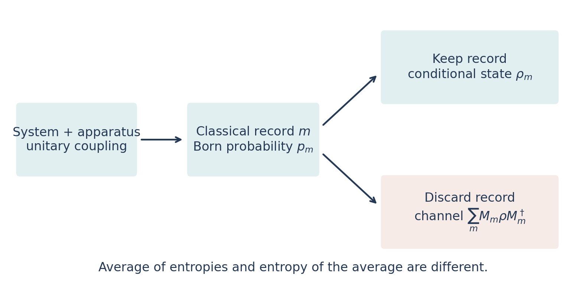

# Welcome and reading guide {.unnumbered}

## The question that organizes this book {.unnumbered}

A quantum system can evolve chaotically and yet become easier to predict when we observe it. Observation can destroy entanglement, create entanglement, protect information, or expose a collective variable that was hidden in a many-body wavefunction. How can these apparently conflicting effects belong to one theory?

The answer begins by distinguishing **a physical state**, **a measurement record**, and **an observer's conditional state**. The record is itself a fluctuating physical object. Its probability depends on the wavefunction, and its correlations can become critical. Consequently, quantum measurement belongs simultaneously to quantum dynamics, classical inference, statistical mechanics, and the theory of quantum codes.

This textbook develops that connection from finite-dimensional quantum mechanics to current research. The work of Romain Vasseur and collaborators is a central thread: replica statistical mechanics of entanglement, measurement-induced criticality, charge sharpening and learnability, symmetry-constrained dynamics, and the emergence of hydrodynamic descriptions. The narrative also develops essential contributions by Li, Chen, Fisher, Skinner, Ruhman, Nahum, Bao, Choi, Altman, Gullans, Huse, Ludwig, Potter, Gopalakrishnan, and many others. Attribution is attached to the specific result rather than used as a substitute for explanation.

## What the reader needs {.unnumbered}

You need complex numbers, elementary linear algebra, derivatives and integrals, and the usual idea of a quantum state. The first three chapters develop tensor products, density matrices, entropy, measurement instruments, conditional probabilities, continuous monitoring, scaling, and replica methods. Later chapters introduce CFT and hydrodynamics at the point where they become necessary. The mathematical toolbox supplies several derivations that can be revisited independently.

Each chapter separates its central model from more general possibilities. A one-dimensional qubit chain with local Haar gates is not interchangeable with a free-fermion chain, an SU(2)-symmetric circuit, or a ground state measured once. Specifying the model and the order of limits is part of the physics.

| Route | Suggested sequence | What it prepares you to do |
|---|---|---|
| First encounter | Foundations → circuits → transition → codes → laboratory | Calculate trajectories and understand why a phase transition is possible |
| Statistical mechanics | Foundations → random circuits → replicas → CFT | Read replica mappings and identify controlled limits |
| Symmetry and information | Measurement → codes → mixed states → charge → non-Abelian → hydrodynamics | Separate entanglement, sharpening, decoding, and symmetry breaking |
| Research seminar | The full sequence, including worked examples and laboratory | Assess assumptions, numerical evidence, and new proposals |

## How claims are qualified {.unnumbered}

**Exact** means an identity or result under the stated assumptions. **Controlled limit** means a derivation justified, for example, at large local dimension or within a Gaussian long-wavelength theory. **Numerical evidence** means behavior observed for specified sizes and models. **Proposal or conjecture** identifies an extrapolation that is not established generally. These distinctions are especially important for replica analytic continuation, nonunitary CFT identifications, and the most recent non-Abelian theories.

The research cutoff is **23 October 2026**. Recent preprints are cited as preprints when their publication status or conclusions require that qualification. A frontier chapter does not imply that a universal answer has been found for every model. Where a complete solution is unknown, the book explains the obstruction and derives the parts that can be established.

## Using the book {.unnumbered}

Equations are numbered and linked. The sidebar, full-text search, and previous/next navigation provide complementary routes through the material. The download menu contains a combined PDF. All scientific illustrations are original; none reproduces a published figure. Static numerical figures are generated from the included Julia simulations and CSV data. They illustrate finite-system behavior and are not used to claim a new critical exponent.

The numerical laboratory includes a dependency-free Julia implementation, validation identities, explicit random seeds, and a small browser experiment. Exercises include solutions so that the book can be used for independent study. Natural logarithms are used unless an entropy is explicitly quoted in bits. We set $\hbar=1$.

This is an AI-assisted scholarly synthesis prepared for study. The bibliography points to the primary scientific record; it is also the place to pursue the unresolved problems identified in the text. The text and original figures are released under CC BY 4.0, and the numerical code under the MIT license.
